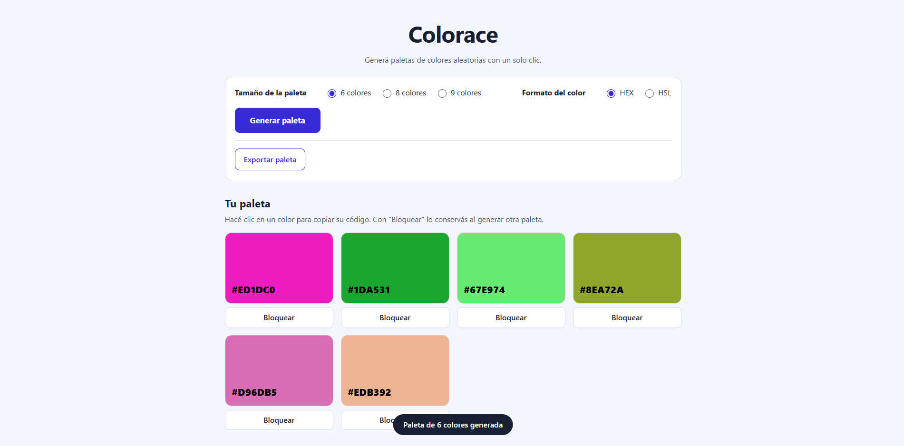
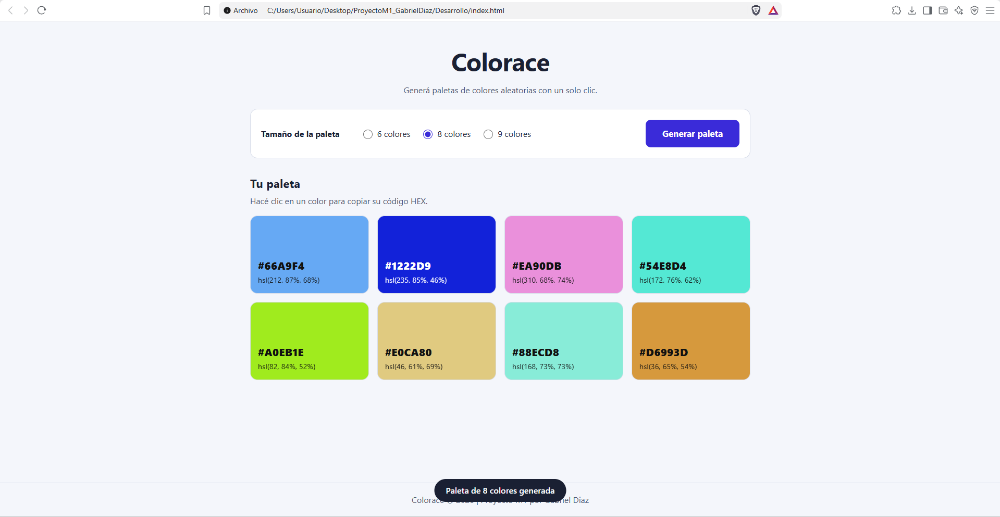
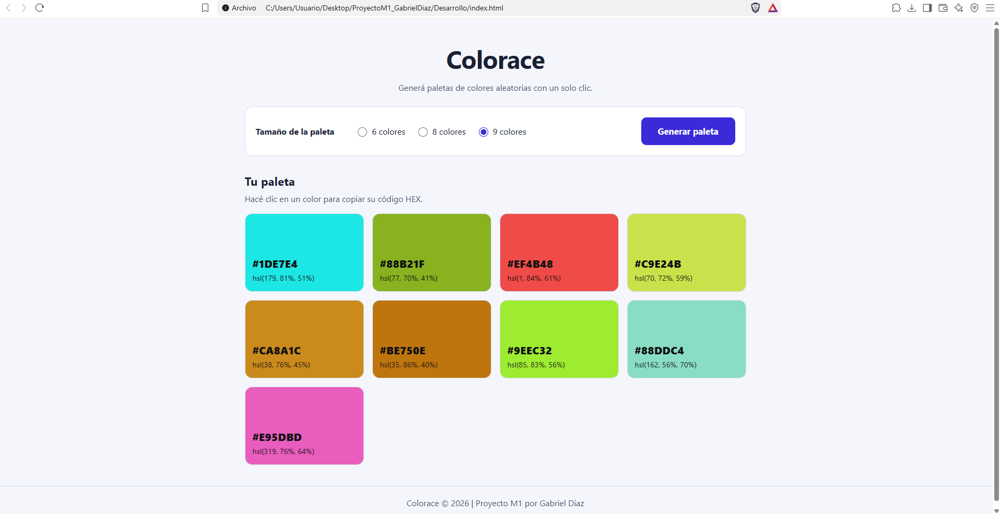
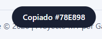

# Colorace | Generador de paletas

Aplicación web estática e interactiva que genera paletas de colores aleatorias con un solo botón. Proyecto M1 de Henry, hecho por **Gabriel Diaz**.

🔗 **Demo:** https://gabiridiaz-stack.github.io/ProyectoM1_GabrielDiaz/






## Funcionalidades

- Botón **Generar paleta** que crea colores aleatorios.
- Tamaño de la paleta a elección: 6, 8 o 9 colores. Al cambiarlo, se regenera sola.
- Cada color se genera en HSL y se muestra junto a su código HEX.
- Clic sobre un color para copiar su HEX al portapapeles.
- Microfeedback con un aviso (toast) al generar y al copiar.

## Tecnologías

HTML5 semántico, CSS3 (variables, Grid, Flexbox), JavaScript (DOM y eventos), Git y GitHub Pages.

## Estructura

```
ProyectoM1_GabrielDiaz/
├── index.html
├── uso-de-ia.md
├── Desarrollo/
│   ├── index.html
│   ├── styles.css
│   └── app.js
└── Documentacion/
    ├── README.md
    └── capturas/
```

## Cómo ejecutarla

1. Cloná el repositorio: `git clone https://github.com/gabiridiaz-stack/ProyectoM1_GabrielDiaz.git`
2. Abrí `Desarrollo/index.html` en el navegador, o usá la extensión Live Server de VS Code.

No requiere instalar nada.

## Cómo desplegarla

1. Subí el proyecto a GitHub (`git add .`, `git commit`, `git push`).
2. En el repositorio: **Settings > Pages > Deploy from a branch > main / (root) > Save**.
3. Esperá un par de minutos y abrí el enlace que muestra GitHub.

## Decisiones técnicas

- **HSL para generar, HEX para mostrar:** en HSL es fácil controlar la saturación y la luminosidad (valores acotados), así los colores salen vistosos y no apagados. Después se convierten a HEX.
- **Sin estilos inline en el HTML:** todo el estilo vive en `Desarrollo/styles.css`. Solo el JavaScript pasa el color de cada muestra mediante variables CSS.
- **Texto legible sobre cualquier color:** se calcula la luminancia del fondo y se elige texto oscuro o blanco según el mayor contraste.
- **`index.html` en la raíz:** GitHub Pages necesita uno ahí, y redirige a `Desarrollo/`.

## Accesibilidad

- Etiquetas `<label>` asociadas a cada opción y `<fieldset>` con `<legend>`.
- Foco visible en todos los elementos interactivos.
- Aviso con `role="status"` para que lo lean los lectores de pantalla.
- Botones con `aria-label` descriptivo y contraste de texto calculado.
- Se respeta `prefers-reduced-motion`.

## Uso de IA

Ver [uso-de-ia.md](uso-de-ia.md).