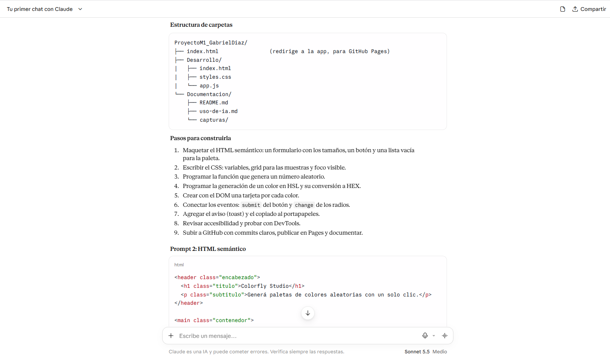
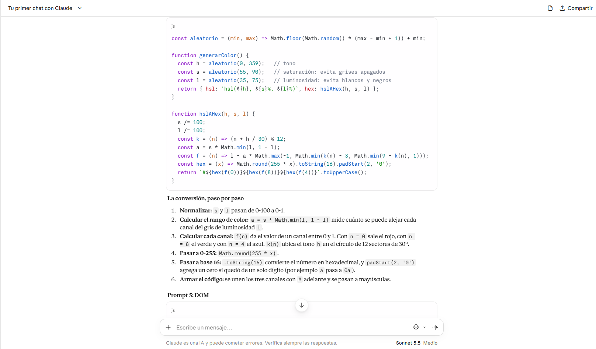
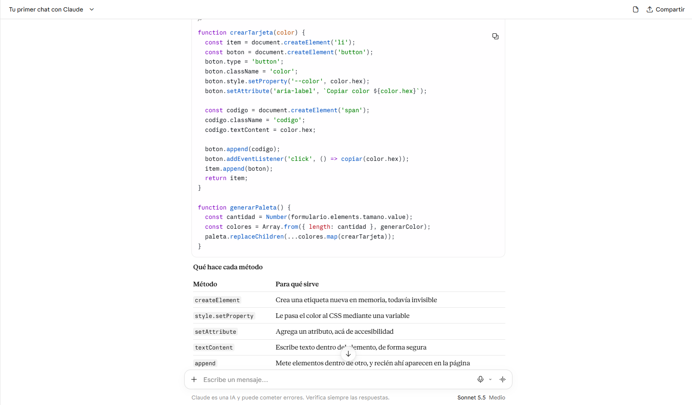
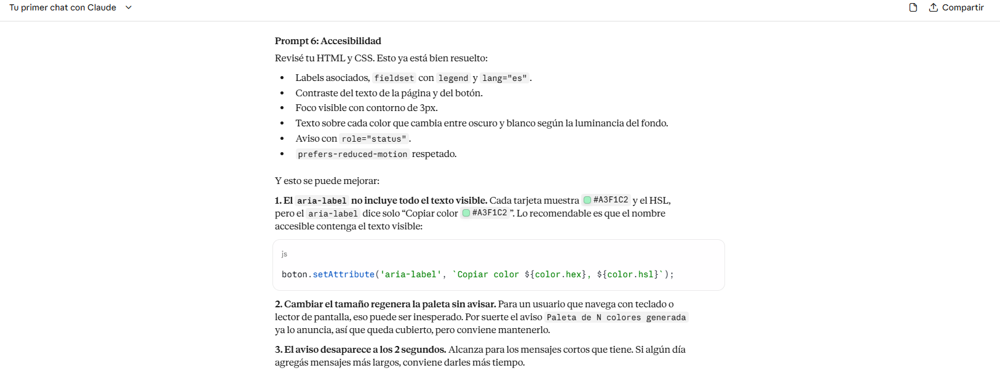
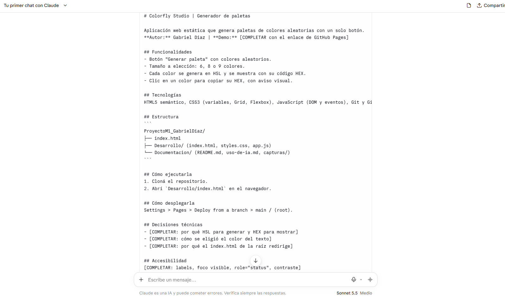

# Uso de la IA

## Claude sonnet 5.5

## Prompt 1: Planificación

```
Soy estudiante de desarrollo frontend y tengo que construir una aplicación web
estática que genere paletas de colores aleatorias (6, 8 o 9 colores) con un solo
botón. Usaré HTML, CSS y JavaScript. Proponeme una estructura de
carpetas y una lista de pasos para construirla.
```




## Prompt 2: Javascript

```
Escribime una función en JavaScript que genere N colores aleatorios en HSL y
los convierta a HEX. Los colores no deben salir ni muy apagados ni casi
blancos o negros. Explicame la conversión paso por paso.
```



## Prompt 3: DOM

```
Escribime el código que cree una tarjeta por cada color usando
document.createElement, la agregue a una lista y reemplace la paleta anterior.
Después explicame qué hace cada método del DOM que usaste.
```



## Prompt 4: Accesibilidad

```
Revisá este HTML y CSS y decime qué puntos de accesibilidad faltan: labels,
contraste, foco, lectores de pantalla. Para cada problema, mostrame cómo
corregirlo.
```



## Prompt 5: Documentacion

```
Armame un README para este proyecto con: descripción, funcionalidades,
tecnologías, estructura de carpetas, cómo ejecutarlo, cómo desplegarlo y
decisiones técnicas.
```



