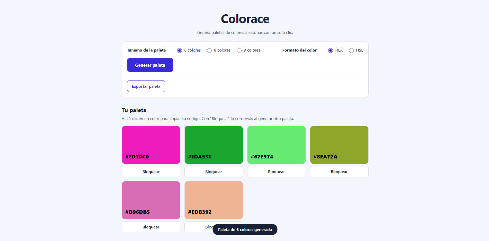

# Colorace | Generador de paletas de colores

Aplicación web estática e interactiva que genera paletas de colores aleatorias con un solo botón. Proyecto Integrador del Módulo 1 de Henry, hecho por **Gabriel Diaz**.

🔗 **Demo en vivo:** https://gabiridiaz-stack.github.io/ProyectoM1_GabrielDiaz/



## Qué hace

- Genera paletas de **6, 8 o 9 colores** aleatorios con el botón **Generar paleta**.
- Cada color se muestra con su código **HEX** y su valor **HSL**.
- Con un clic sobre un color se **copia el HEX** al portapapeles, con un aviso visual.
- Es accesible: HTML semántico, labels asociados, foco visible y contraste de texto calculado.

## Tecnologías

HTML5, CSS3 (variables, Grid), JavaScript (DOM y eventos), Git y GitHub Pages.

## Cómo ejecutarla

1. Cloná el repositorio:
   ```
   git clone https://github.com/gabiridiaz-stack/ProyectoM1_GabrielDiaz.git
   ```
2. Abrí `Desarrollo/index.html` en el navegador.

No requiere instalar nada.

## Estructura del proyecto

```
ProyectoM1_GabrielDiaz/
├── index.html          (redirige a la app para GitHub Pages)
├── uso-de-ia.md
├── Desarrollo/
│   ├── index.html
│   ├── styles.css
│   └── app.js
└── Documentacion/
    ├── README.md
    └── capturas/
```

## Documentación

- 📄 [README completo](Documentacion/README.md): instrucciones, decisiones técnicas y accesibilidad.
- 🖼️ [Capturas del flujo principal](Documentacion/capturas)
- 🤖 [Documentación del uso de la IA](uso-de-ia.md): prompts utilizados y sus resultados.

## Autor

**Gabriel Diaz**

- GitHub: [gabiridiaz-stack](https://github.com/gabiridiaz-stack)
- LinkedIn: [Gabriel Diaz](https://www.linkedin.com/in/gabriel-diaz-132b91322/)
