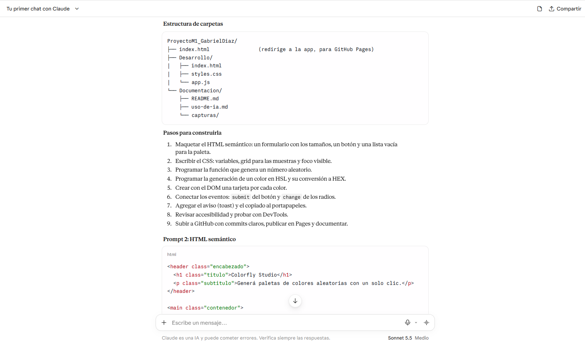
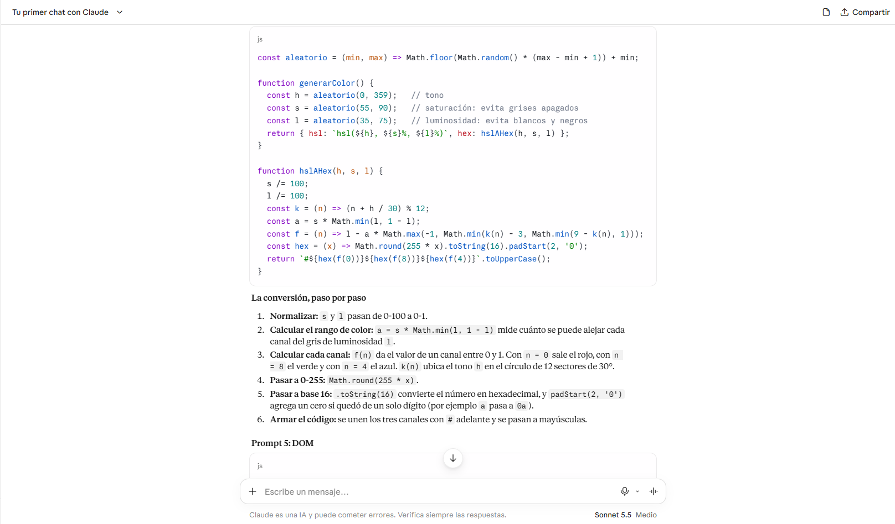
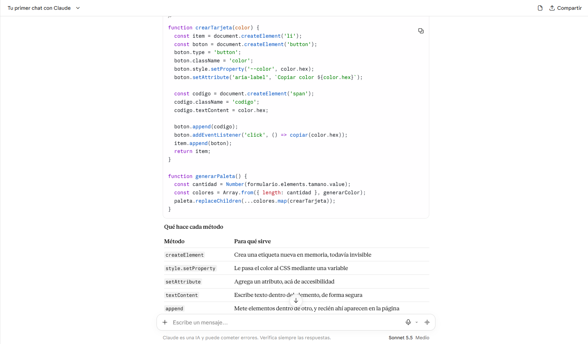
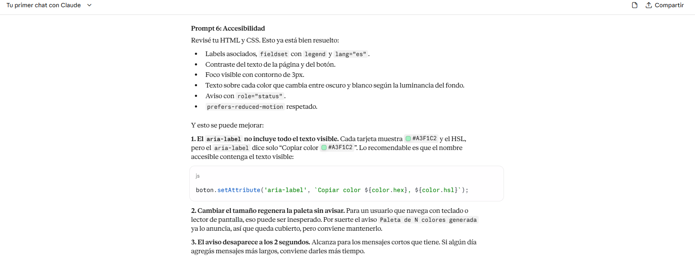
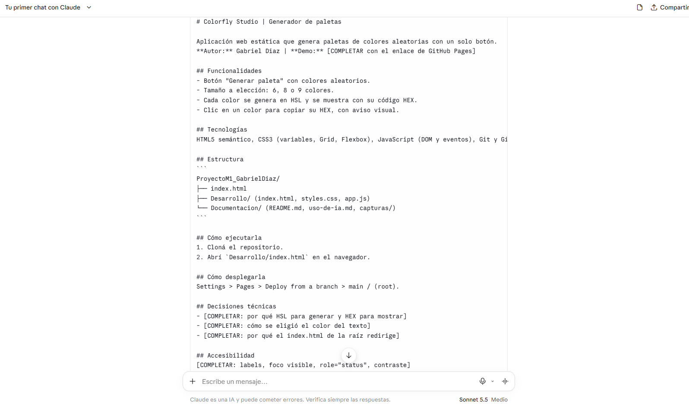

# Uso de la IA

## Claude sonnet 5.5

## Prompt 1: Planificación

```
Soy estudiante de desarrollo frontend y tengo que construir una aplicación web
estática que genere paletas de colores aleatorias (6, 8 o 9 colores) con un solo
botón. Usaré HTML, CSS y JavaScript. Proponeme una estructura de
carpetas y una lista de pasos para construirla.
```
Respuesta / Resultado obtenido:

La IA propuso organizar el proyecto separando los archivos HTML, CSS y JavaScript para facilitar el desarrollo y mantenimiento de la aplicación.

Se estableció una estructura con una carpeta principal para el desarrollo y otra para la documentación. También se definieron las funcionalidades principales: generar paletas de 6, 8 o 9 colores, convertir los colores a formato HEX y permitir al usuario copiar los códigos.

A partir de esta planificación se comenzó con la estructura HTML, luego se trabajó en los estilos CSS y finalmente se incorporó la lógica JavaScript.

Resultado aplicado: Se organizó el proyecto en archivos independientes y se implementaron las funcionalidades principales propuestas.




## Prompt 2: Javascript

```
Escribime una función en JavaScript que genere N colores aleatorios en HSL y
los convierta a HEX. Los colores no deben salir ni muy apagados ni casi
blancos o negros. Explicame la conversión paso por paso.
```
Respuesta / Resultado obtenido:

La IA explicó cómo generar colores aleatorios utilizando el formato HSL (matiz, saturación y luminosidad) y cómo convertirlos al formato hexadecimal HEX.

Se recomendó controlar los valores de saturación y luminosidad para evitar colores demasiado claros u oscuros, logrando paletas con colores más visibles y variados.

También se explicó la importancia de utilizar una función para realizar la conversión de HSL a HEX, permitiendo reutilizar el código y mantenerlo organizado.

Resultado aplicado: Se implementó una función para generar colores aleatorios y otra para convertirlos de HSL a HEX. Esto permitió mostrar los códigos hexadecimales de cada color generado.



## Prompt 3: DOM

```
Escribime el código que cree una tarjeta por cada color usando
document.createElement, la agregue a una lista y reemplace la paleta anterior.
Después explicame qué hace cada método del DOM que usaste.
```
Respuesta / Resultado obtenido:

La IA propuso utilizar métodos del DOM para crear dinámicamente las tarjetas correspondientes a cada color de la paleta.

Se explicó el uso de document.createElement() para crear elementos HTML desde JavaScript, appendChild() para incorporar elementos dentro de otros y replaceChildren() para reemplazar el contenido anterior de la paleta.

También se recomendó separar la creación de las tarjetas en una función para evitar repetir código y facilitar su mantenimiento.

Resultado aplicado: Se implementó la generación dinámica de tarjetas. Cada tarjeta muestra el color correspondiente y su código HEX. Al generar una nueva paleta, se reemplazan las tarjetas anteriores por las nuevas.



## Prompt 4: Accesibilidad

```
Revisá este HTML y CSS y decime qué puntos de accesibilidad faltan: labels,
contraste, foco, lectores de pantalla. Para cada problema, mostrame cómo
corregirlo.
```
Respuesta / Resultado obtenido:

La IA ayudó a identificar aspectos importantes de accesibilidad que debían tenerse en cuenta en la aplicación.

Se recomendaron etiquetas semánticas para organizar el contenido, etiquetas label para relacionar los textos con los controles, indicadores visibles de foco para facilitar la navegación mediante teclado y un contraste adecuado entre el texto y el fondo.

También se sugirió utilizar atributos ARIA para comunicar determinados cambios de la interfaz a los lectores de pantalla.

Resultado aplicado: Se incorporaron etiquetas semánticas, etiquetas asociadas a los controles, estilos de foco visible, avisos accesibles mediante aria-live y mejoras de contraste para facilitar la lectura.



## Prompt 5: Documentacion

```
Armame un README para este proyecto con: descripción, funcionalidades,
tecnologías, estructura de carpetas, cómo ejecutarlo, cómo desplegarlo y
decisiones técnicas.
```
Respuesta / Resultado obtenido:

La IA propuso organizar el README incluyendo una descripción general del proyecto, sus funcionalidades, las tecnologías utilizadas y la estructura de carpetas.

También recomendó agregar instrucciones para ejecutar la aplicación localmente, explicar cómo realizar el despliegue mediante GitHub Pages y documentar algunas decisiones técnicas tomadas durante el desarrollo.

Se destacó la importancia de incluir capturas de pantalla para mostrar visualmente el funcionamiento de la aplicación.

Resultado aplicado: Se elaboró la documentación del proyecto incorporando su descripción, funcionalidades, tecnologías, estructura de archivos, instrucciones de ejecución y despliegue, además de capturas de pantalla.




Conclusión

La Inteligencia Artificial fue utilizada como una herramienta de apoyo para resolver dudas, organizar el proyecto y comprender diferentes conceptos de HTML, CSS y JavaScript.

Las respuestas sirvieron como orientación durante el desarrollo, pero fue necesario revisar, adaptar y probar las propuestas para incorporarlas correctamente a la aplicación.

Este proceso permitió reforzar conocimientos sobre manipulación del DOM, generación de colores y accesibilidad.